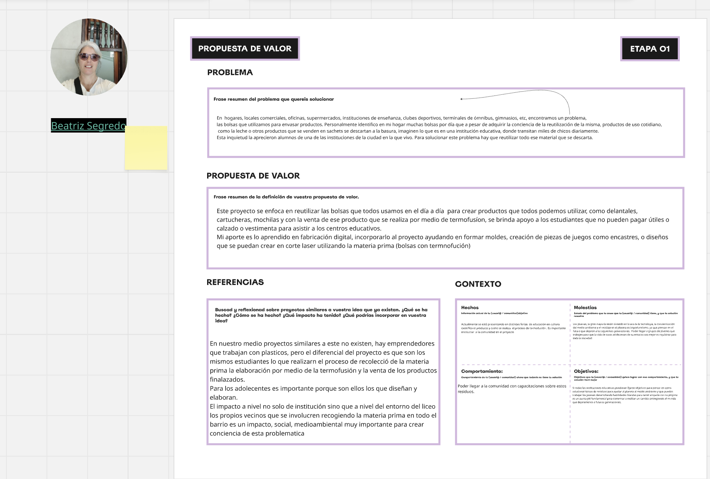
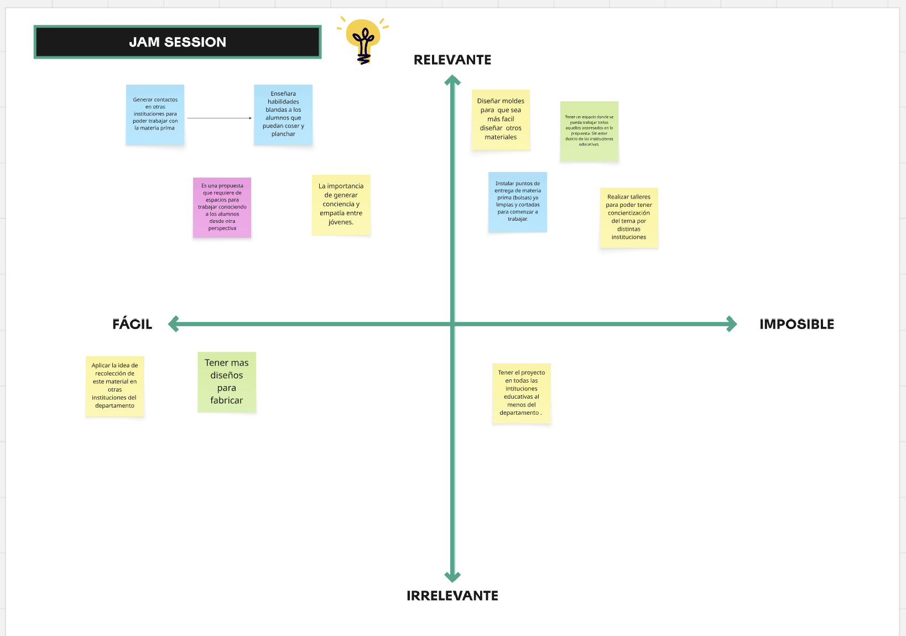
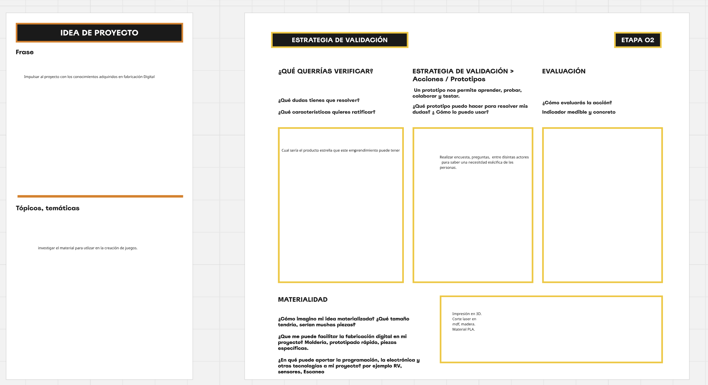

# Ideas iniciales

En noviembre de 2026 usé un tablero de Miro para ordenar las primeras ideas de mi Proyecto Integrador. Partí de una pregunta: ¿cómo podemos reutilizar las bolsas plásticas y convertirlas en productos útiles con la participación de estudiantes?

## Propuesta de valor

Mi idea es recuperar bolsas plásticas y unirlas mediante termofusión para obtener un material con el que se puedan crear nuevos productos. Quiero que los estudiantes participen en la recolección de las bolsas, el diseño y la elaboración. Esa participación es lo que quiero destacar de la propuesta, porque el proyecto también puede ser una oportunidad para aprender sobre reciclaje y cuidado del ambiente.

*Propuesta de valor. La captura reúne la idea de reutilizar las bolsas y el papel de los estudiantes en el proceso.*

## Jam session · Priorización de ideas

En la matriz de Miro ordené las acciones según su relevancia y dificultad. Puse sobre el tablero ideas como contactar a otras instituciones y organizar talleres de concientización. Verlas juntas me ayudó a distinguir cuáles podía explorar primero y cuáles requerían más coordinación.

*Matriz de priorización. Cada nota representa una acción posible para avanzar con el proyecto.*

## Idea de proyecto y estrategia de validación

Una posibilidad que surgió fue explorar el material para crear juegos. Antes de elegir un producto, quiero averiguar qué les resultaría útil a las personas a las que va dirigido el proyecto. Para eso me propongo hacer encuestas y conversar con distintos actores de la comunidad. También me gustaría organizar talleres sobre reciclaje y cuidado del ambiente, que me permitirían compartir la propuesta y recoger comentarios para ajustarla.

*Estrategia de validación. El tablero registra preguntas y acciones para decidir qué producto vale la pena desarrollar.*

## Reflexión sobre el proceso

Trabajar en Miro me ayudó a pasar de una idea general sobre la reutilización de bolsas a una propuesta que puedo explicar y poner a prueba. Al definir la propuesta de valor, entendí que necesitaba expresar qué diferencia a mi proyecto de otras iniciativas similares. También aprendí que la elección del producto depende de escuchar primero a quienes podrían usarlo. En esta etapa dejé planteada la validación para orientar las siguientes decisiones.

