# MT02 y MT03 · Tecnología y Fabricación

En octubre de 2026 trabajé con dos formas de fabricación digital. En el MT02 convertí el cartel del Mercado Municipal de San José en un sello impreso en 3D. En el MT03 diseñé un portalápices de cinco piezas y preparé sus archivos para corte y grabado láser.

## MT02 · Sello del Mercado Municipal de San José

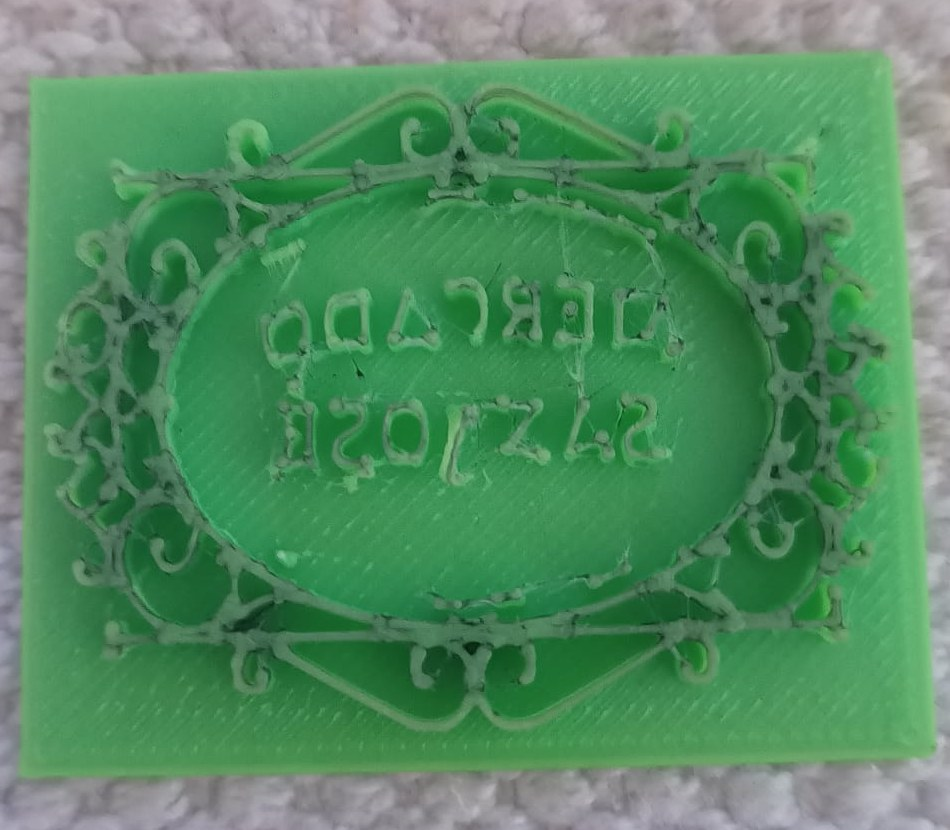

*Resultado impreso. El relieve y las letras invertidas quedan unidos sobre una base de 50 × 40 mm.*

### Del cartel al sello

Para la feria del 3 de octubre de 2026 tomé como punto de partida el cartel del Mercado Municipal de San José, mi lugar de trabajo. Quería conservar el marco ovalado y sus adornos y convertir esa imagen en un sello.

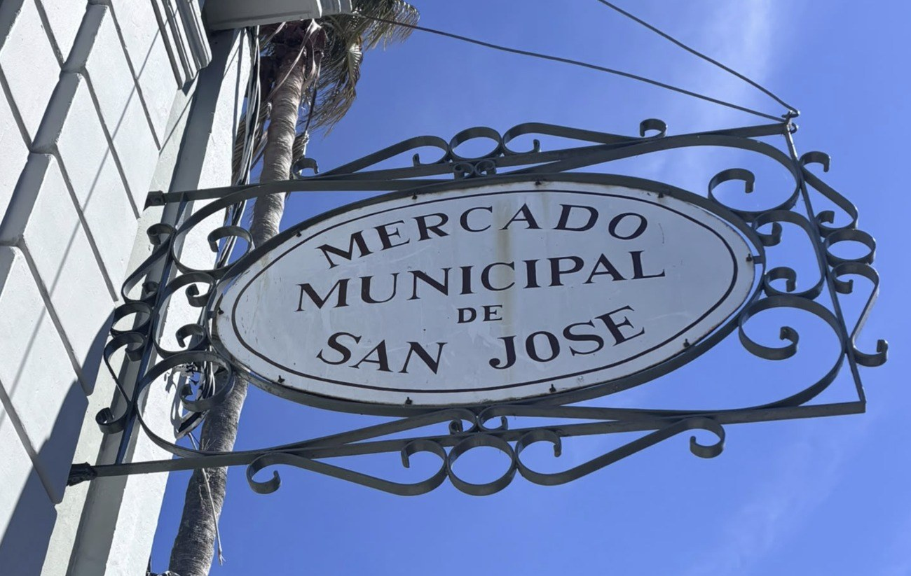

*Fotografía que usé como referencia para el diseño.*

Como la foto mostraba el cartel en perspectiva, usé IA para obtener una versión frontal y plana. En Inkscape trabajé sobre esa imagen para obtener contornos editables. Al principio, al abrir el SVG, seguía viendo la imagen original. El trazado nuevo había quedado superpuesto. Cuando lo moví hacia un costado pude distinguirlo del mapa de bits. También comprobé que Windows podía abrir un SVG con el navegador aunque el archivo siguiera siendo SVG.

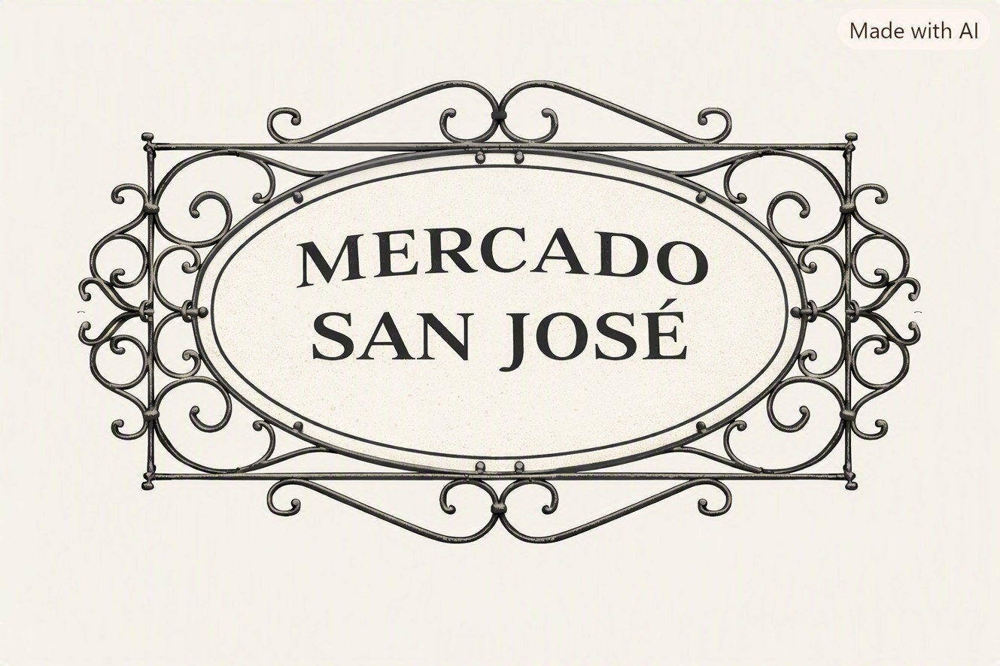

*Imagen de referencia para la vectorización en Inkscape.*

### Del vector a la impresión

Importé el SVG en Tinkercad y trabajé el logo en relieve. Invertí las letras para que se lean en la orientación correcta al estampar. Agregué una base rectangular para sostener las letras del centro y los detalles del marco, que de otro modo quedaban como partes separadas. Exporté el modelo a STL, lo preparé en Cura, generé el G-code e imprimí el sello.

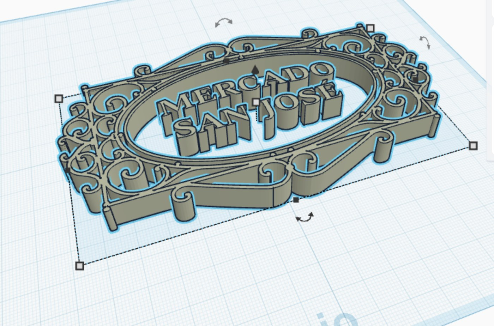

*Vista del relieve durante el modelado. La fotografía del resultado muestra la base incorporada.*

### Qué aprendí

Aprendí a distinguir entre una imagen incrustada y un trazado editable, y a pensar el logo como una pieza que debe poder sostenerse. En una próxima prueba compararía la legibilidad de las letras y los adornos en varias estampas.

### Archivos del MT02

- [Lámina de la entrega con el proceso y el resultado (PDF)](../files/mt02/logo-del-mercado.pdf)
- [Archivo de trabajo de Inkscape con el trazado y la imagen de referencia (SVG)](../files/mt02/mercado-espejo.svg)
- [Modelo del sello con base para impresión (STL)](../files/mt02/sello-mercado.stl)

## MT03 · Portalápices MBS

[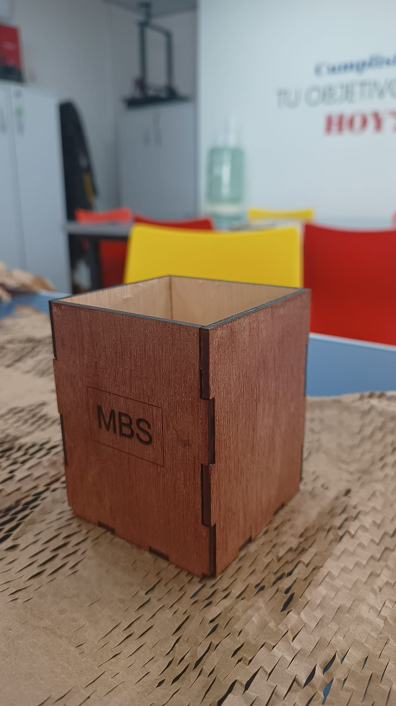{ width="420" }](../images/mt03/portalapices-terminado.jpg)

*Resultado final. En la foto se ven los encastres de las paredes y las iniciales grabadas en el frente.*

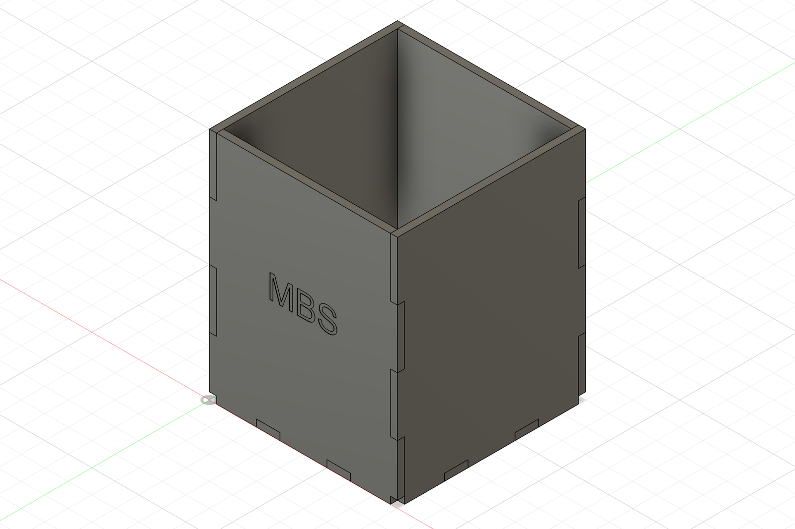

*Modelo digital. Diseñé una base y cuatro paredes para un espesor nominal de 3 mm, con dimensiones exteriores de 80 × 80 × 100 mm.*

### Modelado paramétrico y encastres

En octubre de 2026 elegí diseñar un objeto de escritorio que se pudiera armar por encastre. Personalicé una de las caras con las iniciales «MBS». En Autodesk Fusion definí el ancho, la profundidad, la altura y el espesor como parámetros para poder adaptar las piezas si cambiaba el material o el tamaño del objeto.

En la segunda versión usé dos dientes por borde vertical de cada pared. Revisé el modelo armado y la comprobación digital dio cero interferencias. Probé por separado cambios en el espesor, el ancho, la profundidad y el alto. Después devolví el modelo a las medidas nominales de la entrega.

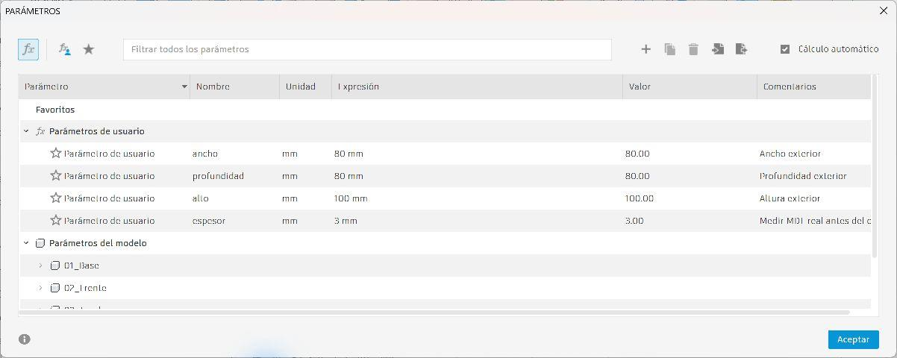

*Parámetros que controlan las dimensiones del modelo.*

### Preparación del plano y del trabajo láser

En Inkscape revisé los perfiles planos de las cinco piezas y convertí las letras «MBS» en trazados. La primera disposición tenía 440 mm de ancho y superaba el ancho disponible de la Falcon2 Pro de 40 W. Reorganicé las piezas en dos filas, en un área de 260 × 210 mm, conservando sus dimensiones.

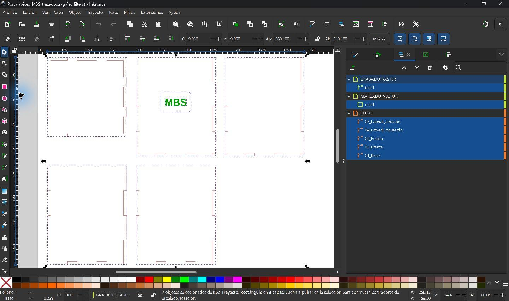

*Distribución de los perfiles para preparar el corte.*

En LightBurn separé las operaciones por color y revisé su orden en la vista previa.

| Orden | Capa | Operación |
| --- | --- | --- |
| 1 | Verde | Grabado raster de «MBS» en modo relleno |
| 2 | Azul | Marcado vectorial del marco |
| 3 | Roja | Corte vectorial del contorno de las piezas |

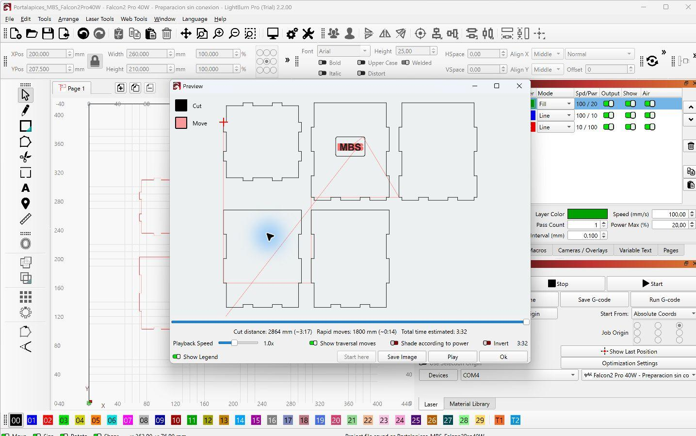

*Vista previa del grabado, el marcado y el corte antes de la fabricación.*

### Corte, grabado y armado

Después de preparar el archivo en LightBurn, corté las cinco piezas y armé el portalápices. En la plancha se distinguen los contornos de la base y las cuatro paredes, el marco marcado y las iniciales «MBS» grabadas.

[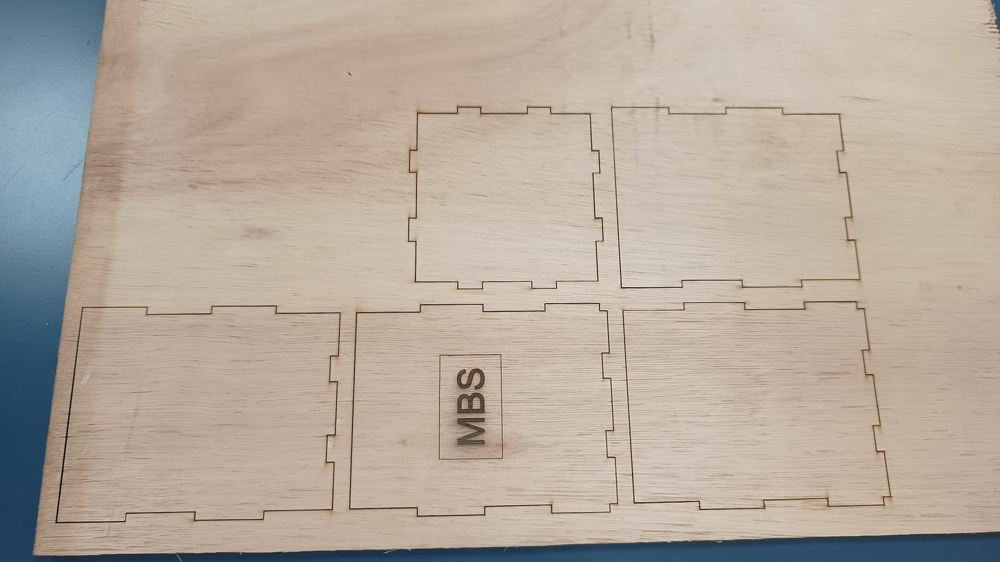](../images/mt03/piezas-en-plancha.jpg)

*Las piezas todavía en la plancha, antes del armado.*

[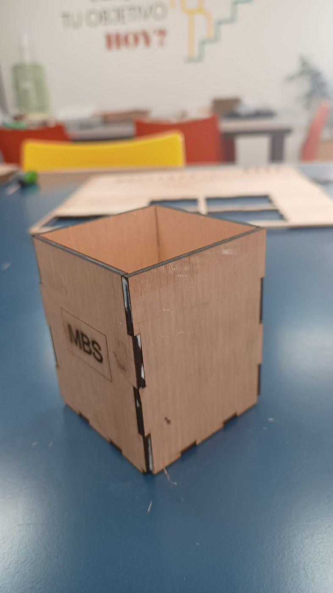{ width="220" }](../images/mt03/detalle-encastres.jpg)
[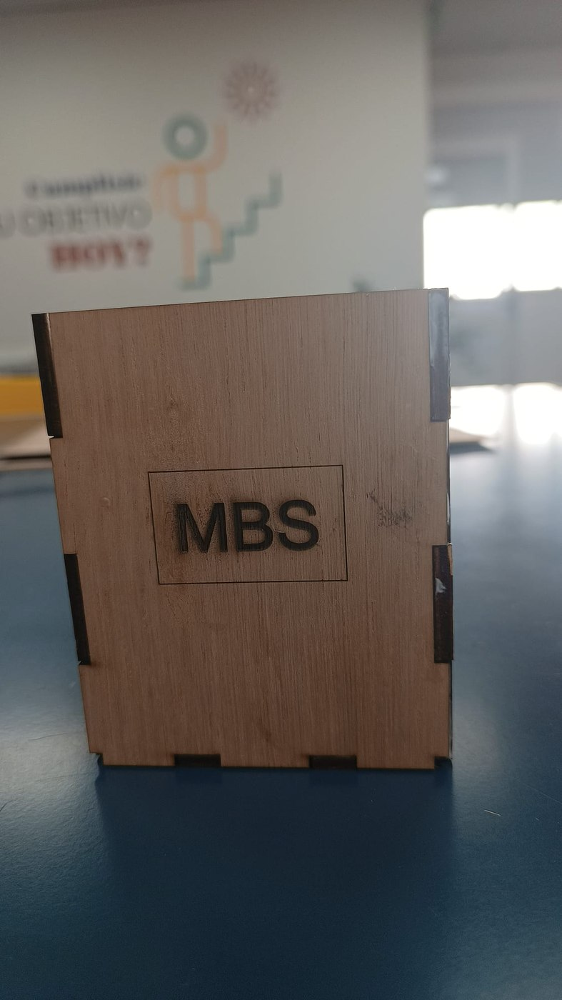{ width="220" }](../images/mt03/detalle-grabado.jpg)
[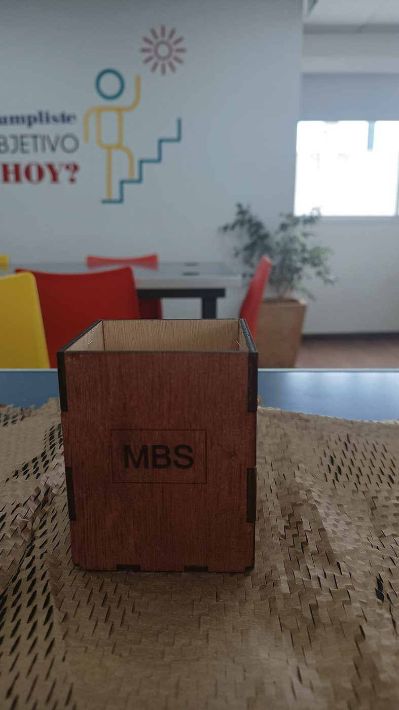{ width="220" }](../images/mt03/vista-frontal-terminada.jpg)

*Detalles del armado, del grabado y del frente terminado. Las fotos se pueden ampliar con un clic.*

[Ver el video del portalápices MBS en YouTube](https://youtube.com/shorts/fLHTWKa-H-k?feature=share)

### Qué aprendí

El cambio de distribución me mostró que el tamaño del objeto armado y el espacio que ocupan sus piezas desplegadas son dos medidas distintas. Con el portalápices armado pude comparar el resultado con el modelo digital y ver cómo quedaron las uniones y el grabado. Para una próxima versión, haría una muestra de encastre antes de cortar todas las piezas para ajustar la unión al espesor real de la plancha y al ancho del corte.

### Archivos del MT03

- [Modelo paramétrico editable de Fusion (F3D)](../files/mt03/Portalapices_MBS.f3d) y [exportación 3D (STEP)](../files/mt03/Portalapices_MBS.step)
- [Plano editable de Inkscape (SVG)](../files/mt03/Portalapices_MBS.svg) y [versión con el texto convertido a trazados (SVG)](../files/mt03/Portalapices_MBS_trazados.svg)
- [Plano vectorial a escala 1:1 (PDF)](../files/mt03/01_Plano_vectorial.pdf) e [informe con el proceso, las vistas y las capturas (PDF)](../files/mt03/02_Proceso_y_vistas.pdf)
- [Proyecto editable de LightBurn (LBRN2)](../files/mt03/Portalapices_MBS_Falcon2Pro40W.lbrn2)
- [Galería de capturas del MT03 (ZIP)](../files/mt03/capturas-portalapices.zip)

## Referencias y uso de IA

- **MT02.** La referencia visual fue el cartel del Mercado Municipal de San José, que fotografié para el ejercicio. Usé IA para generar una vista frontal a partir de la foto. También consulté a ChatGPT sobre cómo comprobar que el SVG contenía trazados y cómo compartir el modelo editable de Tinkercad. 
- **MT03.** Usé Codex como apoyo para construir y comprobar el modelo paramétrico, preparar los archivos para láser y registrar el proceso. El pedido partió de mi propuesta de un «porta lapices en mdf, de cinco piezas encastrables, con la base y cuatro lados, con un espesor de 3mm», con un grabado raster que dijera «MBS».
